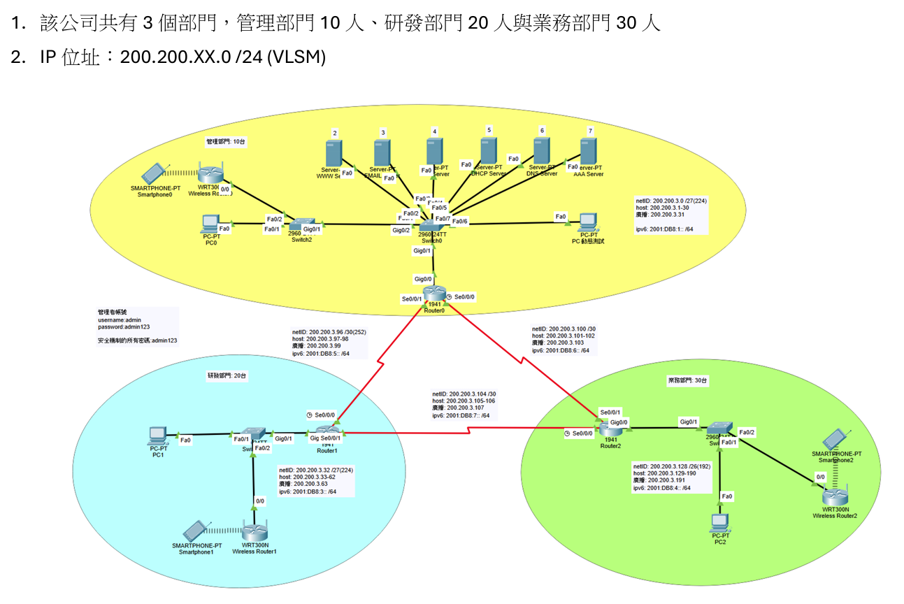

# 小型企業安全雙協定網路規劃與實作 (Enterprise Network Design with Dual Stack & Security)

本專案基於 Cisco Packet Tracer 規劃並建置一套中小型企業級網路架構。整合 VLSM 子網路切割、IPv4/IPv6 Dual Stack 雙協定、六大企業核心伺服器服務、AAA RADIUS 企業級無線身分驗證，以及全設備資安防禦加固。

---

## 專案規格與需求

1. **部門規模**：
   - 業務部門：30 人
   - 研發部門：20 人
   - 管理部門：10 人（含企業伺服器農場 Server Farm）
2. **網路協定**：Dual Stack（IPv4 與 IPv6 雙架構無縫並行）
3. **IP 規劃**：指定網段 `200.200.3.0/24`，利用 VLSM（可變長度子網遮罩）進行最佳化子網劃分
4. **伺服器與無線服務**：內部部署 Web、Email、FTP、DHCP、DNS 與 Wi-Fi 企業認證（AAA/RADIUS Server）
5. **資安機制**：全面啟動 Router、Switch 及 Wireless Router 之防禦機制（密碼加密、長度限制、暴力破解阻擋、SSH 加密遠端連線）

---

## 網路拓撲圖 (Topology)



- **核心架構**：採用三角網狀（Mesh）路由器互連架構（Router 0, Router 1, Router 2），確保路由備援與路徑最佳化。

---

## IP 位址與 VLSM 設計

依據各部門主機需求大小（從大到小）進行 VLSM 子網路劃分：

| 區域 / 網段 | 需求主機數 | 可用 IP 數量 | IPv4 網路位址 (Network ID) | 子網路遮罩 (Mask) | IPv4 可用 IP 範圍 | 廣播位址 (Broadcast) | IPv6 網段 |
| :--- | :---: | :---: | :--- | :--- | :--- | :--- | :--- |
| **業務部門 (Sales)** | 30 | 62 | `200.200.3.128/26` | `255.255.255.192` | `200.200.3.129 - 190` | `200.200.3.191` | `2001:DB8:4::/64` |
| **研發部門 (RD)** | 20 | 30 | `200.200.3.32/27` | `255.255.255.224` | `200.200.3.33 - 62` | `200.200.3.63` | `2001:DB8:3::/64` |
| **管理部門 + Server** | 10 + 6 | 30 | `200.200.3.0/27` | `255.255.255.224` | `200.200.3.1 - 30` | `200.200.3.31` | `2001:DB8:1::/64` |
| **WAN 連結 (R0 - R1)** | 2 | 2 | `200.200.3.96/30` | `255.255.255.252` | `200.200.3.97 - 98` | `200.200.3.99` | `2001:DB8:2::/64` |
| **WAN 連結 (R0 - R2)** | 2 | 2 | `200.200.3.100/30` | `255.255.255.252` | `200.200.3.101 - 102` | `200.200.3.103` | `2001:DB8:5::/64` |
| **WAN 連結 (R1 - R2)** | 2 | 2 | `200.200.3.104/30` | `255.255.255.252` | `200.200.3.105 - 106` | `200.200.3.107` | `2001:DB8:6::/64` |

---

## 核心服務建置與驗證說明

1. **Dual Stack (IPv4 & IPv6)**：
   - 終端 PC 與 Router 介面均配發 IPv4/IPv6 雙位址。
   - 跨網段互 ping（IPv4/IPv6）以及 `tracert` 路由追蹤均 100% 成功連通。
2. **伺服器服務 (Server Farm)**：
   - **DNS Server**：建立 A Record (IPv4) 與 AAAA Record (IPv6) 解析 `www.yzu.edu.tw` 與 `mail.yzu.edu.tw`。
   - **Web Server**：提供內部 HTTP 服務，終端瀏覽器順利讀取網頁。
   - **Email Server**：啟用 SMTP / POP3 服務，各部門使用者可收發內部信件。
   - **FTP Server**：依部門帳號權限（Admin, User）分配讀寫與刪除權限。
   - **DHCP Server**：針對各部門切分 Bu-Pool、In-Pool 及 ServerPool，自動配發對應網段之 IP、Gateway 與 DNS。
3. **Wi-Fi 與 AAA (RADIUS) 安全認證**：
   - 無線 AP 採用 **WPA2-Enterprise (AES)** 加密模式。
   - 整合 AAA Server（RADIUS，Port 1645），使用者需透過獨立帳號密碼（如 `ma / ma456`）通過驗證方可連上無線網路。

---

## 設備資安加固配置 (Device Security)

所有路由器（Router）與交換器（Switch）均落實以下 Cisco IOS 安全機制：

```cisco
! 1. 啟用密碼服務加密
service password-encryption

! 2. 強制密碼長度至少 8 碼
security passwords min-length 8

! 3. 防範暴力破解 (120秒內嘗試失敗3次，鎖定登入60秒)
login block-for 60 attempts 3 within 120

! 4. 設定特權模式加密密碼
enable secret <Secure_Password>

! 5. 限制 Console 與 VTY 遠端連線安全 (逾時自動登出)
line con 0
 exec-timeout 5 0
 login
line vty 0 4
 exec-timeout 5 30
 login local
 transport input ssh   ! 僅允許 SSH 加密遠端連線，禁用不安全的 Telnet
```

---

## 如何開啟與執行

1. 安裝 **Cisco Packet Tracer**（建議版本 8.0 以上）。
2. 下載本專案：
   ```bash
   git clone [https://github.com/你的用戶名/你的專案名稱.git](https://github.com/你的用戶名/你的專案名稱.git)
   ```
3. 開啟 `packet_tracer/enterprise_network.pkt` 即可載入完整拓撲與設定進行模擬。